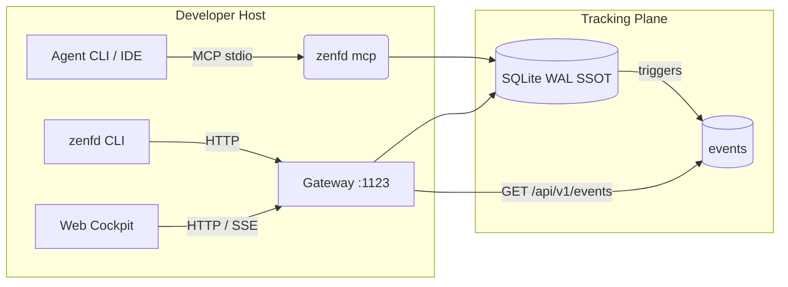

# ZenForge Daemon (zenfd) Architecture & Seams

ZenForge Daemon is an agent-native tracking plane: SQLite WAL is the Single
Source of Truth, MCP and the CLI are the write paths, and the HTTP gateway is a
read-only viewer with a real-time stream.

## Boundaries

- **Write paths**: MCP tools and the `zenfd` CLI. HTTP keeps a small public
  write surface (plan ingestion, status, claim, archive, media upload) for
  scripted clients, guarded against cross-origin browsers.
- **Read path**: the Web Cockpit is read-only and consumes `GET` endpoints plus
  the SSE stream.
- **Activity log**: database triggers append every plan/task/artifact mutation to
  `events`, so writes from MCP or the CLI in another process are visible in the
  cockpit live log. Rows older than 30 days are pruned at startup.
