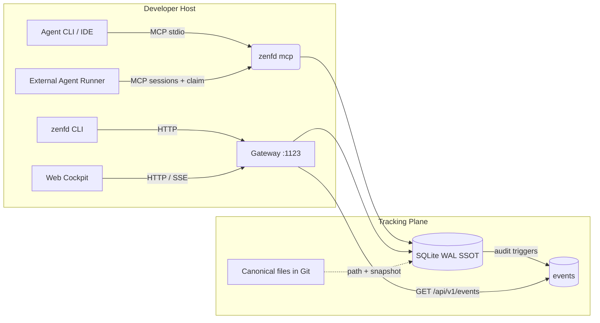

# ZenForge Daemon (zenfd) Architecture & Seams

ZenForge Daemon is an agent-native tracking plane: SQLite WAL is the Single
Source of Truth for execution state, MCP and the CLI are the primary write paths,
and the HTTP gateway serves both the read-only cockpit and definition CRUD for
projects, documents, and agents.



## Domain model (v0.2)

```text
project <- plans <- tasks
```

- A plan always belongs to one project (`project_slug` required).
- A task has exactly one scope: plan task (`plan_slug` + `project_slug`), project
  task (`project_slug`, no plan), or orphan (neither).
- Dependencies are validated within the task's container: `plan:<slug>`,
  `project:<slug>`, or `orphan`.
- Document content is file-canonical; the database stores identity (`key`,
  `slug`), classification (`type`, `scope`, `status`), tags, SHA-256, byte size,
  and an FTS5 snapshot. Keys and slugs are unique per project
  (`IFNULL(project_slug,'')`); global documents have an empty project.
- Agent definitions (persona, mode, goal, start/stop conditions, schedule,
  runner) are stored by the daemon; execution is external. Sessions are observed
  as `MAIN`, `SUBAGENT`, or `WORKER`.

## Boundaries

- **Execution write path**: MCP tools (`projects`, `plans`, `tasks`, `docs`,
  `agents`, `sessions`, `search`, `claim_task`, `review`, `transition_task`) and
  the `zenfd` CLI. HTTP keeps a public definition/ingestion surface for
  scripted clients, guarded against cross-origin browsers.
- **Definition write path**: the Web Cockpit may CRUD projects, document registry
  entries, and agent definitions. It never creates, claims, or transitions a
  task, and never drives a session.
- **Read path**: the cockpit consumes `GET` endpoints plus the SSE stream.
- **Activity log**: database triggers append every project/plan/task/document/
  agent/session/artifact mutation to `events`, so writes from MCP or the CLI in
  another process are visible in the cockpit live log. Rows older than 30 days
  are pruned at startup. `StateFingerprint` is `MAX(events.id)`.

## Default ports and storage

| Component | Default |
| :--- | :--- |
| Gateway | `127.0.0.1:1123` |
| Database | `~/.zenforge/state.db` (SQLite WAL) |
| Attachments | `~/.zenforge/attachments/<task>/` |
| Web bundle | Embedded in the single `zenfd` binary |

## Migration policy

v0.2 is a clean break. `storage.Open` detects the legacy v0.1 plan schema and
drops the old tracking tables before applying the current migration, because
v0.1.3 data was disposable mock state. No dual-write or compatibility columns
remain.
