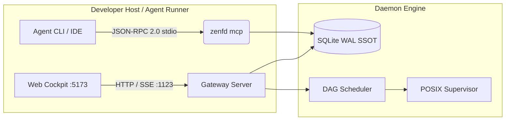

# ZenForge Daemon (zenfd) Architecture & Seams

ZenForge Daemon is an agent-native operating environment combining SQLite WAL as Single Source of Truth with Model Context Protocol (MCP) and POSIX process group supervision.

## Detailed Subsystem Specifications

- **Domain & Interface Contracts**: [docs/zenfd/contracts.md](zenfd/contracts.md)
- **Web Cockpit UI Layout**: [docs/zenfd/ui-layout.md](zenfd/ui-layout.md)
