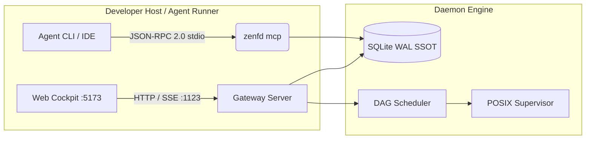

# ZenForge Daemon (zenfd) Architecture & Seams

> Category: ARCHITECTURE | Version: 1

# ZenForge Daemon (zenfd) Architecture

ZenForge Daemon is an agent-native operating environment combining SQLite WAL as Single Source of Truth with Model Context Protocol (MCP) and POSIX process group supervision.

