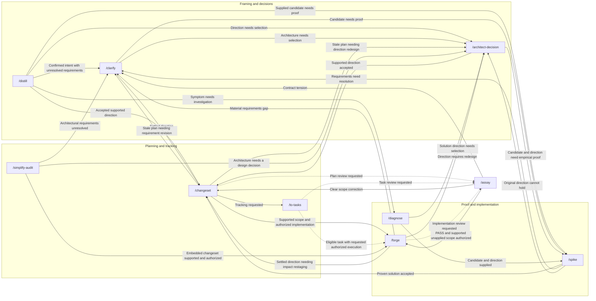
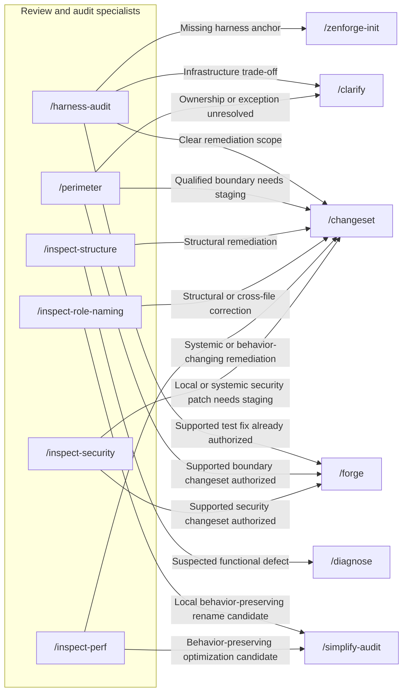
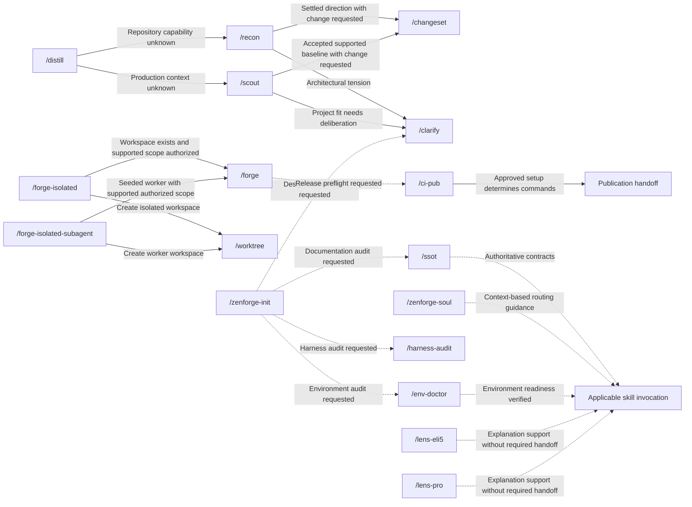

# ZenForge Skill Connections

This document owns the connection map for all 27 skills. Three views show the same
network; repeated nodes refer to the same skill. Arrows describe conditional
handoffs, not a required sequence of invocations.

Input/output and state criteria belong to each skill. Shared authoring semantics
belong to [Construction Rules](ZENFORGE_CONSTRUCTION_RULES.md#11-input-state--routing).
The reviewed framing, proof, planning, and implementation contracts are applied
below; other skill responsibilities and specialist verdicts are retained.

## Reading the Map

Solid arrows describe handoffs or wrapper composition with the prerequisite on
the edge. Dashed arrows describe optional review, support, or caller-requested
follow-up. Potential graph edges are not an output menu: select actual handoffs
under the Construction Rules, and complete the request without another skill
when no gap remains. A handoff carries evidence, constraints, and the applicable
authorization; an arrow supplies none of these by itself.

## Framing, Proof, Planning, and Delivery

`diagnose` ends at a root-cause report; it does not fix production.
`spike` receives a problem and candidate/direction, and only explores alternatives
inside that direction. Unverified assumptions or missing access remain explicit
gaps rather than evidence of success or failure.

`simplify-audit` can embed its own changeset; it does not call `changeset` just to
stage that artifact. `to-tasks` records work and splits only when useful, ending
after verified publication unless implementation is separately requested.
`forge` ends at verified implementation and a proposed commit message; a
necessary redesign is a separate handoff, not an implementation adjustment.

## Inspection and Remediation

A clean audit can finish without remediation. Locality does not establish behavior
equivalence: security patches, new query limits, or public contract changes need
their own supported changeset. Routes to `simplify-audit` request inspection and
staging, never direct refactoring.

## Context, Governance, Isolation, and Release

Context endpoints are not extra skills. Wrapper edges describe composition,
not alternative recommendations; workspace creation or dispatch does not prove
worker completion. Release readiness does not establish publication. Explanation,
mapping, documentation lookup, initialization, and worktree list/delete may end
without a downstream invocation.

## Source Contracts

- Framing: [distill](../skills/distill/SKILL.md), [clarify](../skills/clarify/SKILL.md), [architect-decision](../skills/architect-decision/SKILL.md), [contract-freeze](../skills/contract-freeze/SKILL.md), [seam-plan](../skills/seam-plan/SKILL.md).
- Proof: [diagnose](../skills/diagnose/SKILL.md), [spike](../skills/spike/SKILL.md), [skeleton-spike](../skills/skeleton-spike/SKILL.md), [tdd](../skills/tdd/SKILL.md).
- Planning and implementation: [changeset](../skills/changeset/SKILL.md), [split-tasks](../skills/split-tasks/SKILL.md), [tracking-tasks](../skills/tracking-tasks/SKILL.md), [to-tasks](../skills/to-tasks/SKILL.md), [forge](../skills/forge/SKILL.md), [simplify-audit](../skills/simplify-audit/SKILL.md).
- Review: [assay](../skills/assay/SKILL.md), [harness-audit](../skills/harness-audit/SKILL.md), [perimeter](../skills/perimeter/SKILL.md), [inspect-structure](../skills/inspect-structure/SKILL.md), [inspect-role-naming](../skills/inspect-role-naming/SKILL.md), [inspect-perf](../skills/inspect-perf/SKILL.md), [inspect-security](../skills/inspect-security/SKILL.md).
- Support: [recon](../skills/recon/SKILL.md), [scout](../skills/scout/SKILL.md), [ssot](../skills/ssot/SKILL.md), [env-doctor](../skills/env-doctor/SKILL.md), [zenforge-init](../skills/zenforge-init/SKILL.md), [zenforge-soul](../skills/zenforge-soul/SKILL.md), [lens-pro](../skills/lens-pro/SKILL.md), [lens-eli5](../skills/lens-eli5/SKILL.md).
- Isolation and release: [worktree](../skills/worktree/SKILL.md), [forge-isolated](../skills/forge-isolated/SKILL.md), [forge-isolated-subagent](../skills/forge-isolated-subagent/SKILL.md), [ci-pub](../skills/ci-pub/SKILL.md).
